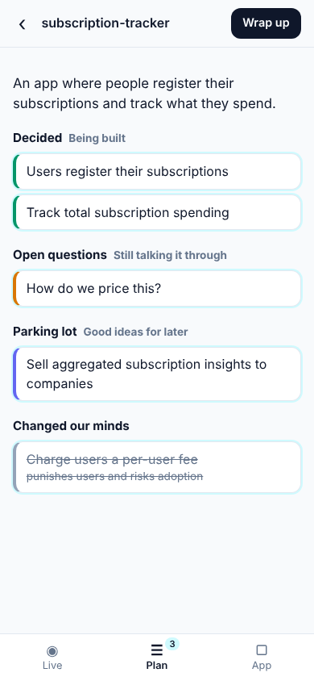
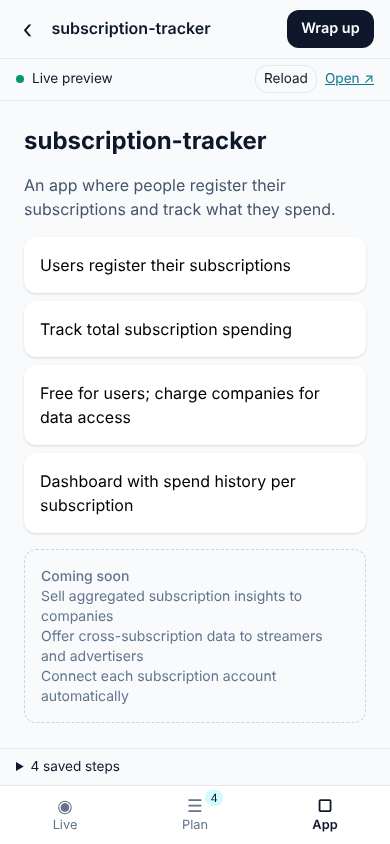
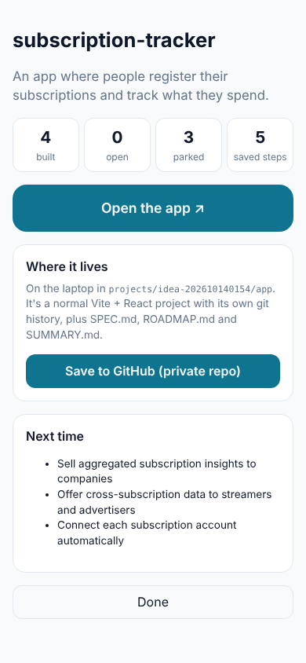
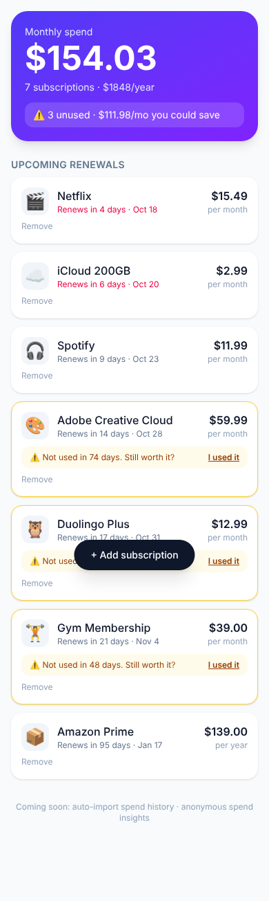

# Ambient Builder

Two friends talk about an idea over coffee. One of them taps **Start a conversation**, and a coding agent builds the app in the background while they talk:

- What they **decide** gets built, and a live preview on the phone updates every minute or two.
- What's still **open**, or a good idea for **later**, goes on the plan and roadmap instead of into code.
- When they **change their minds** ("per-user pricing? no, that punishes users"), the old idea is marked superseded and removed from the app.
- By the end there's a small app to demo. It's a normal project folder with a git history, and you can push it to GitHub with one tap.
- Next time, tap **Continue** on the idea and keep going where you left off.

| Plan (from the conversation) | Live preview | Wrap-up |
|---|---|---|
|  |  |  |

The screenshots above use the mock builder. Below is what one **real** builder turn produced from the sample conversation in [`fixtures/subscription-convo.txt`](fixtures/subscription-convo.txt), in about 50 seconds:



## How it works

```
 phone / laptop browser                      your laptop (this repo)
 ┌──────────────────────┐   audio or text   ┌──────────────────────────────────────────────────┐
 │ mic ▸ 16 kHz PCM     │ ────────────────▶ │ whisper.cpp (local, free) ▸ transcript           │
 │                      │                   │        ▼ every ~30s                              │
 │ Live │ Plan │ App    │ ◀──── updates ─── │ Analyst (Claude Haiku) ▸ Spec Ledger             │
 │              iframe ◀┼──── preview ───── │   decided / open / roadmap / superseded          │
 └──────────────────────┘                   │        ▼ when something is decided               │
                                            │ Builder (Claude Code, Sonnet) edits app/ ▸ git   │
                                            │        ▼                                         │
                                            │ Vite dev server (hot reload) ▸ /preview/<id>/    │
                                            └──────────────────────────────────────────────────┘
```

- **The analyst** never writes code. It turns rambling conversation into a structured ledger, and it notices reversals ("no no, that would risk adoption").
- **The builder** gets *only what changed in the ledger*, never the raw transcript. It runs one turn at a time. Anything decided while it works is queued and merged into the next turn. It resumes the same Claude Code session every time, including in later conversations, so it remembers the codebase.
- **Every builder turn becomes a git commit** in the app's own local repo.

## It runs on your Claude subscription

The builder and analyst run **Claude Code on your laptop**, through the [Claude Agent SDK](https://code.claude.com/docs/en/agent-sdk/overview). They use whatever account you're logged into with `claude`. On startup, the server **removes `ANTHROPIC_API_KEY`** from what it passes to Claude Code, so you aren't billed per token by accident. Set `AMBIENT_USE_API_KEY=1` if you'd rather use a key.

Two things to know:

- **This is for personal use.** Anthropic's terms let you use your own Pro/Max login for your own Claude Code and Agent SDK use. They do **not** let you offer your login to other users or route their requests through your plan ([legal and compliance](https://code.claude.com/docs/en/legal-and-compliance)). Sharing your laptop at the table is fine. If this becomes a product for other people, switch the builder to API-key auth. The `Builder` interface in `server/src/builder/builder.ts` is the place to do that.
- **It uses your plan's limits.** A one-hour conversation might run 10–30 builder turns, which uses up part of your 5-hour and weekly limits. The analyst runs on Haiku and the builder on Sonnet. You can change both with `AMBIENT_ANALYST_MODEL` and `AMBIENT_BUILDER_MODEL`.

## Setup (once, on the laptop)

You need **Node 20+**, **git**, and **Claude Code** logged in (`npm i -g @anthropic-ai/claude-code`, then `claude` and `/login`).

```bash
npm run setup            # installs this app and pre-caches the starter template's packages
npm run whisper:setup    # optional: free local speech-to-text (whisper.cpp + base.en model, ~150 MB)
```

## Try it without talking (no mic, no Claude usage)

```bash
npm run mock             # canned analyst + builder; open the printed link
```

Tap **▶ Try the sample conversation**. The sample plays at 2× speed, and you'll see the plan fill in and the preview change.

For the real thing with the sample conversation, run `npm start`, tap the same button, and watch Claude build it.

## Use it at coffee

**Terminal 1** (speech-to-text, if you ran `whisper:setup`):

```bash
npm run whisper
```

**Terminal 2**:

```bash
npm start      # laptop only: open the printed http://localhost:4317/?key=… link
npm run tunnel # phone too: prints an https://….trycloudflare.com link and a QR code
```

Phones only allow the microphone over **HTTPS**. `npm run tunnel` uses a free [Cloudflare quick tunnel](https://developers.cloudflare.com/cloudflare-one/connections/connect-networks/do-more-with-tunnels/trycloudflare/), which needs no account. Install it once with `brew install cloudflared`. You can also show the QR code from the laptop UI with **📱 Open on phone**.

Then tap **Start a conversation** and talk. Put the phone face-up on the table. The screen stays on while listening, because a sleeping phone stops the mic. Glance at the **App** tab whenever you like. Use **Type a note** to correct things, for example "call it SubTrack". When you're done, tap **Wrap up**.

**Speech-to-text options (all free):**

| Mode | When it's used | Notes |
|---|---|---|
| whisper.cpp on the laptop | When `npm run whisper` is running | Private, works with phone or laptop mic, ~5–10 s behind |
| Browser speech recognition | When Whisper isn't running | Zero setup in Chrome, unreliable on iOS, sends audio to the browser vendor |
| Typed notes | Always | |

Deepgram and AssemblyAI both have free signup credits and would add speaker labels. They'd plug in as a `Transcriber` in `server/src/transcribe/`.

**Get consent.** Everyone at the table should know they're being recorded. Transcripts are saved in `projects/<id>/transcript.jsonl`.

## Where your app lives

You don't need to create a GitHub repo or plan anything ahead of time.

1. **Start** copies [`templates/starter-app`](templates/starter-app) (Vite + React + Tailwind) to `projects/<id>/app/`, runs `git init` there (local only), and starts its dev server.
2. The analyst **names the project** from the conversation, for example `subscription-tracker`. Tap the name to rename it.
3. Each builder turn **edits files and commits**. `SPEC.md` and `ROADMAP.md` in the app stay in sync with the plan.
4. **Wrap up** runs a final build, writes `SUMMARY.md` and commits.
5. **Save to GitHub** creates a *private* repo named after the project with `gh repo create` and pushes. If GitHub isn't connected, the app stays local and the button tells you to run `gh auth login` once. You can save it later from the home screen.

Afterwards it's a normal standalone project. Run it with `npm install && npm run dev`, open it in Claude Code, or tap **Continue** for another conversation.

## Safety notes

- **Every request needs the access token** in the printed link. Opening the link once sets a cookie. This matters because the tunnel makes your laptop reachable from the internet, and cloudflared connects from localhost, so the server can't tell local visitors from remote ones by address. Set a fixed token with `AMBIENT_TOKEN`.
- **The builder is fenced in, but not sandboxed.** It can only edit files inside the app folder, and it can only run a short list of commands (npm, file utilities; no git, curl, or paths outside the folder). See `server/src/builder/permissions.ts`. This is a guardrail on Claude's tool calls, not a security boundary: it still runs `npm install` on your machine.

## Configuration

| Env var | Default | |
|---|---|---|
| `PORT` | `4317` | |
| `AMBIENT_TOKEN` | random per start | Access token in the link |
| `AMBIENT_PROJECTS_DIR` | `./projects` | Where ideas are stored |
| `AMBIENT_ANALYST_MODEL` / `AMBIENT_BUILDER_MODEL` | `haiku` / `sonnet` | |
| `AMBIENT_ANALYST_INTERVAL_MS` | `30000` | How often the plan updates. It also updates early after ~150 new words |
| `AMBIENT_USE_API_KEY` | off | Use `ANTHROPIC_API_KEY` instead of your login |
| `AMBIENT_MOCK` | off | Canned analyst and builder, no Claude calls |
| `WHISPER_URL` | `http://127.0.0.1:8178` | whisper.cpp server |

## Development

```bash
npm test          # unit + integration tests (mock analyst/builder)
npm run typecheck
npm run e2e       # Playwright: plays the sample conversation through the UI in mock mode
npm run replay -- subscription-convo.txt --speed 3   # feed a fixture into a running server
```

Code map:
- `server/src/session/sessionManager.ts`: the loop (transcript → analyst → ledger → builder → commit)
- `server/src/analyst/`: ledger schema, merge/diff logic, and the analyst prompt
- `server/src/builder/`: Claude Code builder, its prompt, and permission guardrails
- `server/src/preview/viteManager.ts`: one Vite dev server per project, proxied at `/preview/<id>/`
- `server/src/publish/github.ts`: Save to GitHub
- `web/`: the phone UI, an installable web app

## Roadmap

- Speaker labels ("who said it"), and a "that's wrong" button on plan items
- An API-key or cloud-sandbox builder backend, so this can serve other people (and run without the laptop)
- Several phones in one conversation
- A one-tap public demo link (Cloudflare Pages or Netlify) at wrap-up
